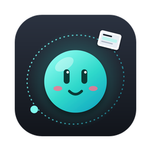

  

<h1 align="center">Alpi</h1>

  A small floating companion for your Mac – screenshots, recordings and file conversion in one place. 
  <b>Public beta · free while it's in beta</b>

  <a href="https://github.com/turqislabs/alpi/releases/latest/download/Alpi.dmg"><b>⬇︎ Download Alpi.dmg</b></a> ·
  <a href="https://turqislabs.netlify.app/alpi/">Website</a> ·
  <a href="docs/Alpi-User-Guide.pdf">User guide (PDF)</a> ·
  <a href="CHANGELOG.md">Changelog</a> ·
  <a href="#deutsch">Deutsch</a>

---

Alpi floats on your desktop (or lives in the menu bar). Every screenshot lands in Alpi's
**Orbit** as a card you can drag anywhere, edit, pin or turn into text. Drop files on Alpi
to convert them.

- **Capture** – area, window, full screen, **scrolling capture**, text from an area, self-timer
- **Record** – screen video (MP4/GIF) with clicks, microphone, system audio and a camera bubble
- **Edit** – arrows, text, highlights, counters, **redaction** (auto-detects e-mails, IBANs, faces …), beautiful frames
- **Smart** – text recognition, QR codes, dates → calendar, tables → Excel, colour picker, clipboard history
- **Convert** – images, PDFs, Office documents, video → GIF … by drag & drop
- **Ask Alpi** – type what you want (“PDF from the selected images, then park them”); with Apple Intelligence on macOS 26/27, Alpi can also describe and name screenshots
- **Automate** – folder rules and actions for the Shortcuts app

> **Language:** the app is in **German** for now. English is planned – the user guide is already in English.

## Install

1. [Download **Alpi.dmg**](https://github.com/turqislabs/alpi/releases/latest/download/Alpi.dmg), open it and drag **Alpi** into **Applications**.
2. Start Alpi. It's signed and notarized by Apple, so it opens normally.
3. On the first screenshot macOS asks for **Screen & System Audio Recording** – allow it and restart Alpi once.

Optional permissions, only when you use the feature: Accessibility (auto-scroll, paste from the clipboard history),
Camera and Microphone (recordings), Automation (Office conversion, Finder selection).

**Requirements:** macOS 14 Sonoma or later. Apple Intelligence features need macOS 26 or later on Apple silicon
with Apple Intelligence turned on; understanding images needs macOS 27.

**Updates:** Alpi checks GitHub once a day and tells you when a new version is out (you can turn this off).

## Privacy

Alpi works entirely on your Mac – no account, no analytics, no uploads. Text recognition, redaction and Apple
Intelligence run on-device. The only network request Alpi makes on its own is the daily update check to GitHub,
which sends nothing about you or your files. Clipboard history is kept in memory only and skips passwords.
Details: [privacy policy](https://turqislabs.netlify.app/alpi/privacy.html).

## Feedback

This is a beta – bugs are expected and every report helps.

- In Alpi: **menu bar icon › Feedback geben** (fills in your Alpi and macOS version)
- Here: [report a bug](https://github.com/turqislabs/alpi/issues/new?template=bug_report.yml) · [suggest an idea](https://github.com/turqislabs/alpi/issues/new?template=feature_request.yml)
- No GitHub account: [musa.oezdil@icloud.com](mailto:musa.oezdil@icloud.com)
- Security issues: please see [SECURITY.md](SECURITY.md) instead of opening a public issue.

## Beta and pricing

Alpi is **free during the beta**. Version 1.0 will keep a free basic version and offer a one-time
purchase for the full feature set. Beta testers will get a thank-you when 1.0 launches.

## Licence

Alpi is free to use during the beta but is not open source – see [TERMS.md](TERMS.md).
It contains code from [Tendedero](https://github.com/alejandrobujan/tendedero) by Alejandro Buján (MIT) –
see [THIRD_PARTY_NOTICES.md](THIRD_PARTY_NOTICES.md).

Made by **turQis Labs**, Berlin.

---

## Deutsch

**Alpi** ist ein kleiner schwebender Begleiter für den Mac: Screenshots (auch scrollend), Bildschirmvideos,
Editor mit Schwärzen, Texterkennung, QR-Codes, Zwischenablage-Verlauf, Umwandeln per Drag & Drop und
„Frag Alpi“ mit Apple Intelligence. Die App ist auf Deutsch.

**Öffentliche Beta – kostenlos, solange sie Beta ist.**

1. [**Alpi.dmg** laden](https://github.com/turqislabs/alpi/releases/latest/download/Alpi.dmg), öffnen und Alpi in „Programme“ ziehen.
2. Alpi starten – die App ist von Apple notarisiert.
3. Beim ersten Screenshot die Bildschirmaufnahme erlauben und Alpi einmal neu starten.

Voraussetzung: macOS 14 oder neuer; Apple-Intelligence-Funktionen ab macOS 26 auf Apple-Chips.

Alles läuft auf deinem Mac, nichts wird hochgeladen. Nur einmal am Tag fragt Alpi bei GitHub, ob es eine
neue Version gibt (abschaltbar).

Feedback: in Alpi über **Menüleisten-Symbol › Feedback geben**, hier als
[Fehler](https://github.com/turqislabs/alpi/issues/new?template=bug_report.yml) /
[Idee](https://github.com/turqislabs/alpi/issues/new?template=feature_request.yml) oder per
[E-Mail](mailto:musa.oezdil@icloud.com). Danke fürs Testen!
